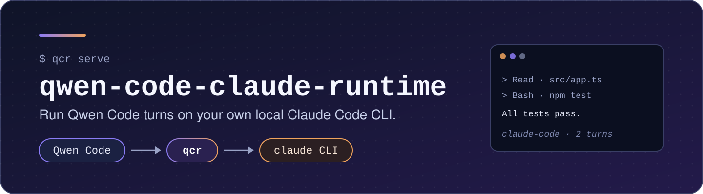
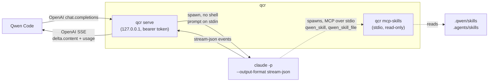
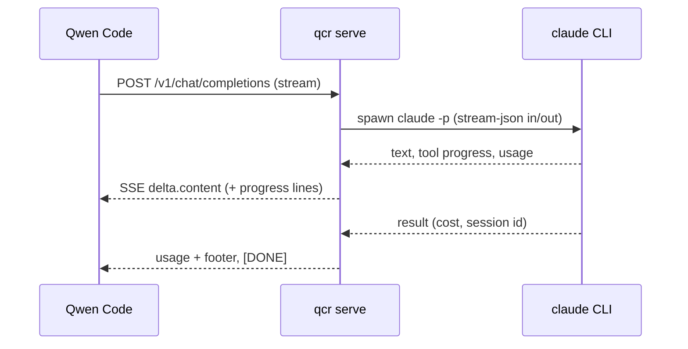

<div align="center">



# qwen-code-claude-runtime

**Run [Qwen Code](https://github.com/QwenLM/qwen-code) turns on your own local Claude Code CLI.**

[](LICENSE)
[](package.json)
[](https://github.com/zhuanyi/qwen-code-claude-runtime/stargazers)
[](https://github.com/zhuanyi/qwen-code-claude-runtime/commits/main)
[](https://github.com/zhuanyi/qwen-code-claude-runtime/pulls)

[Quick start](#-quick-start) · [How it works](#-how-it-works) · [Configuration](#-configuration) · [Security](SECURITY.md) · [Design](docs/PLAN.md)

</div>

---

Use Claude Code as a switchable runtime inside [Qwen Code](https://github.com/QwenLM/qwen-code). Pick it like
any other model (`/model claude-code/sonnet`). The turn then runs through **your own installed `claude` CLI**,
on your own login or subscription. Claude Code runs the tools itself (Read, Edit, Bash, …), and its streamed
text, tool progress, token usage and errors appear in Qwen Code. Switch back to a Qwen model at any time.

> Status: **MVP / early development**. Design: [`docs/PLAN.md`](docs/PLAN.md). Review record:
> [`docs/REVIEW.md`](docs/REVIEW.md). Manual test checklist: [`docs/E2E.md`](docs/E2E.md).

## 🤔 Why

* Keep Qwen Code's UI and workflow while letting Claude Code do the work for a given turn.
* No patch to Qwen Code: `qcr` speaks the OpenAI chat-completions protocol that Qwen Code already supports.
* No credential handling: the official `claude` binary uses its own login. See the policy below.

## ✨ Features

* 🔌 **Drop-in model**: a local OpenAI-compatible server on `127.0.0.1`, protected by a bearer token.
* 🛠️ **Claude runs the tools**: tool calls are shown as progress lines; `qcr` never returns `tool_calls`, so Qwen does not run them twice.
* 📡 **Streaming**: Claude's text arrives as `delta.content`, with token usage and a cost footer.
* 🧵 **Session continuity**: later turns use `claude --resume <id> --fork-session`; existing history is passed as quoted context.
* 🧰 **Skills bridge**: Qwen skills are exposed to Claude via a read-only MCP server (`qwen-skills`).
* 🔗 **MCP passthrough**: your Qwen `mcpServers` are handed to `claude --mcp-config`.
* 🚦 **Clear errors**: `claude` missing, not logged in, quota exhausted (with reset time), unknown model.
* 🔒 **Safe defaults**: no shell spawn, prompt over stdin, `bypassPermissions` refused, `ANTHROPIC_*` stripped from the child env.

## 🔐 Credentials policy

This project only spawns the official `claude` binary as a subprocess and lets it use its own login.
It **never** reads, copies, proxies or extracts Claude OAuth tokens or other credentials, never touches
`~/.claude` credential files or the OS keychain, and never calls `api.anthropic.com` itself.
See [SECURITY.md](SECURITY.md).

## 🧭 How it works



`qcr` is a small, dependency-free local server that speaks the OpenAI chat-completions protocol, which stock
Qwen Code already supports. Qwen Code needs no patch. For each turn, `qcr` does the following:

* Spawns `claude -p --input-format stream-json --output-format stream-json …`. The prompt goes over stdin, never
  through argv.
* Streams Claude's text back as `delta.content`. Each Claude tool call shows up as a progress line such as
  `> ⚙ Read · src/app.ts`. `qcr` **never** returns `tool_calls` on a chat turn, so Qwen does not run the tools a
  second time.
* Returns token usage, and appends a footer with Claude's reported cost (`_claude-code · 2 turns · $0.0123_`).
* Keeps the conversation going across turns: later turns use `claude --resume <id> --fork-session`. When Claude
  joins a conversation that already has history (for example after you switch from a Qwen model), the earlier
  history is passed to it as quoted context.
* Exposes your Qwen skills (`.qwen/skills`, `.agents/skills`, project then user) to Claude through a small built-in,
  read-only stdio MCP server, `qwen-skills` (tools `qwen_skill` and `qwen_skill_file`). Disable with `QCR_SKILLS=off`.
* Passes your Qwen `mcpServers` from `~/.qwen/settings.json` to `claude --mcp-config`. Servers you marked
  `"trust": true` there are pre-allowed for Claude. Project-level `<project>/.qwen/settings.json` servers are
  used only when you set `QCR_PROJECT_MCP=1`: a cloned repository could otherwise make `claude` start arbitrary
  commands. Project servers are never auto-trusted.
* Turns failures into clear errors: `claude` not installed, not logged in, quota exhausted (with the reset time),
  unknown model.

<details>
<summary><b>Per-turn sequence</b></summary>



</details>

## 🚀 Quick start

Requirements: Node ≥ 20, Qwen Code, and Claude Code (`claude`) installed and logged in. Run `claude` once
interactively and complete `/login`.

```bash
git clone https://github.com/zhuanyi/qwen-code-claude-runtime && cd qwen-code-claude-runtime
npm link            # installs the `qcr` command (no dependencies)

cd ~/my-project     # Claude works in the directory where qcr runs
qcr serve           # listens on http://127.0.0.1:8787/v1
export QCR_TOKEN="$(qcr token)"   # in the shell where you will start qwen
```

Add a provider entry to `~/.qwen/settings.json`:

```jsonc
{
  "modelProviders": {
    "openai": [
      {
        "id": "claude-code/sonnet",
        "name": "Claude Code (sonnet, local CLI)",
        "baseUrl": "http://127.0.0.1:8787/v1",
        "envKey": "QCR_TOKEN",
        "generationConfig": { "timeout": 1800000, "contextWindowSize": 200000 }
      },
      { "id": "claude-code/opus", "baseUrl": "http://127.0.0.1:8787/v1", "envKey": "QCR_TOKEN",
        "generationConfig": { "timeout": 1800000 } }
    ]
  },
  // Recommended while using Claude Code as the main model:
  "fastModel": "<one of your Qwen models>",          // keeps titles/summaries off Claude
  "memory": { "enableManagedAutoMemory": false },     // avoids an extra claude run per turn
  "ui": { "enableFollowupSuggestions": false }
}
```

Then, in Qwen Code, run `/model claude-code/sonnet` (or pick it from `/model`) and keep chatting. Very long
agent turns may also need `QWEN_STREAM_MAX_LIFETIME_MS=0` in the environment where `qwen` runs, because Qwen
caps a single stream at 15 minutes by default.


## 🔧 Configuration

<details>
<summary><b>qcr serve environment variables</b></summary>

| Variable | Default | Meaning |
|---|---|---|
| `QCR_BACKEND` | `claude` | Agent CLI that runs each turn: `claude` (Claude Code) or `reasonix` ([Reasonix](#-using-reasonix)) |
| `QCR_PORT` | `8787` | Listen port (always `127.0.0.1`) |
| `QCR_TOKEN` | generated | Bearer token. Without it, a token is generated once into `~/.config/qwen-claude-runtime/token` (0600) |
| `QCR_CWD` | current dir | Working directory for `claude`. Requests from a Qwen session in a different directory are refused |
| `QCR_CLAUDE_BIN` | `claude` | Path to the official Claude Code binary |
| `QCR_REASONIX_BIN` | `reasonix` | Path to the Reasonix binary (`QCR_BACKEND=reasonix`) |
| `QCR_PERMISSION_MODE` | `manual` | `manual`, `acceptEdits` or `plan` (`plan` is claude-only). `bypassPermissions` and other auto-approve modes are **refused** |
| `QCR_ALLOWED_TOOLS` | – | Extra allow rules for the backend's own tool names, comma-separated, e.g. `Edit,Bash(npm test)` for claude or `write_file,bash(npm test)` for reasonix |
| `QCR_MCP` | on | `off` stops passing Qwen MCP servers to Claude (claude only) |
| `QCR_SKILLS` | on | `off` stops exposing Qwen skills to Claude (the `qwen-skills` MCP server; claude only) |
| `QCR_PROJECT_MCP` | off | `1` also passes `<project>/.qwen/settings.json` MCP servers (never auto-trusted) |
| `QCR_MAX_CONCURRENCY` | `4` | Maximum simultaneous `claude` turns. Further requests get `429 qcr_busy` |
| `QCR_TURN_TIMEOUT_MS` | `1800000` | Wall-clock limit per turn |
| `QCR_TOOL_PROGRESS` | `content` | `off` hides the tool progress lines |
| `QCR_FOOTER` | on | `off` hides the cost footer |
| `QCR_KEEP_ANTHROPIC_ENV` | – | `1` keeps all `ANTHROPIC_*` and `CLAUDE_CODE_USE_{BEDROCK,VERTEX,FOUNDRY}` variables for the child. By default they are removed so that `claude` uses your subscription login rather than a key or provider set for something else |

**Permissions:** with `-p`, nobody can answer Claude's permission prompts, so any action that would prompt is
denied (`--permission-prompts none`). Denials are reported in the reply with a hint. Allow what you need with
`QCR_ALLOWED_TOOLS`, your Claude settings, or `QCR_PERMISSION_MODE=acceptEdits`.

</details>

## 🐋 Using Reasonix

[Reasonix](https://github.com/esengine/DeepSeek-Reasonix) (npm `reasonix`, tested with 1.38.7) is a DeepSeek-based coding
agent CLI. Only 1.38.7 has been verified (npm's `latest` is now a 2.x release, which is untested).
With `QCR_BACKEND=reasonix`, `qcr` runs each turn with
`reasonix -p --output-format stream-json --model <m> --permission-mode <mode> --dir <cwd>` (prompt on stdin) instead
of `claude`. Everything on the Qwen Code side (streaming, progress lines, usage, `[DONE]`, `qcr_busy`, resume) works
the same way.

```bash
npm i -g reasonix@1.38.7 && reasonix setup   # or export DEEPSEEK_API_KEY=... where qcr runs
cd ~/my-project
QCR_BACKEND=reasonix qcr serve
```

Use model ids `reasonix/<model>` in Qwen Code's `modelProviders` (for example `reasonix/deepseek-flash` or
`reasonix/deepseek-pro`; any model your Reasonix config accepts works). Later turns run
`reasonix … --resume <session id> --copy`, so each turn continues a copy of the previous session and the original is
never modified.

Differences from the Claude backend:

* Reasonix uses its own login/config (`DEEPSEEK_API_KEY` or `reasonix setup`). `qcr` does not read or forward the key;
  `reasonix` inherits the environment `qcr` runs in.
* Qwen MCP passthrough and the `qwen-skills` server are not used. Configure MCP servers with `reasonix mcp`.
* `QCR_PERMISSION_MODE=plan` is refused (Reasonix only plans interactively). In `manual`, anything that needs
  approval (such as a file write) is denied and reported with a hint; `acceptEdits` allows file edits.
* The footer shows Reasonix's cost and currency only when Reasonix reports a complete cost.
* While Reasonix retries a rate-limited or failing provider request, a `> ↻ Reasonix is retrying …` line is shown.

## 🚧 Known gaps (MVP)

* Qwen skills are exposed to Claude through a local MCP server (see above). Qwen *tools* are not yet exposed, and
  extension, bundled and custom skill directories are not yet discovered.
* Context files (`QWEN.md`) reach Claude only through Qwen's own startup context on the first Claude turn.
* `includeTools` / `excludeTools` in MCP configs are ignored (a warning is logged).
* Continuity depends on Qwen sending back the assistant text it received. If Qwen compresses the history, the
  next turn starts a new Claude session with the history as quoted context.
* Only one project directory per `qcr` process.
* No images or attachments. No interactive permission prompts.

## 🧪 Development

```bash
npm test     # unit + integration tests; uses test/fake-claude.js, never the real CLI
```

## 🙏 Acknowledgements

The design borrows from OpenClaw's `claude-cli` agent runtime ([openclaw/openclaw](https://github.com/openclaw/openclaw),
MIT): treating the CLI as a runtime behind a model id, using stream-json I/O, removing `ANTHROPIC_*` variables from
the child environment, and passing MCP servers via `--mcp-config`. No OpenClaw code is copied.

## 📄 Licence

MIT. Qwen Code is Apache-2.0; this repository contains no Qwen Code source. Claude Code is a product of Anthropic and is
used here only as an external program that the user installs themselves.
